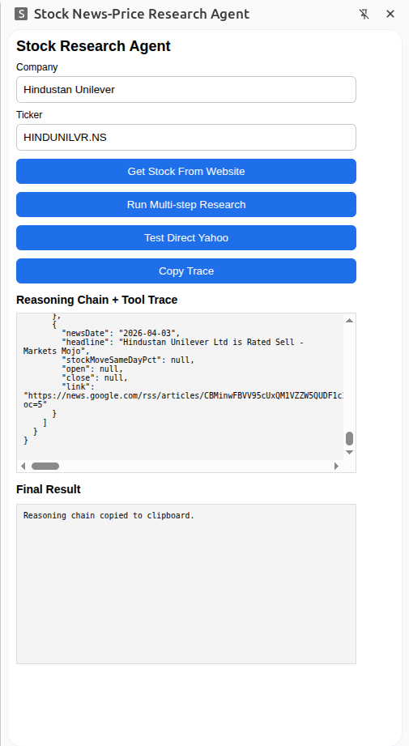

# Stock Intelligence Platform

**Multi-step tool-using agent** in a Chrome Side Panel: Gemini plans research, calls tools (news → prices → link), and surfaces a **visible reasoning + tool trace** for every run.

**What a recruiter should notice:** orchestrated tool use with copyable traces—not a black-box chatbot.

> **Disclaimer:** Educational / demo only. Output is **not investment advice**.

---

## Demo

Screenshot of the side-panel run (reasoning chain + tool calls + verdict):



*TODO: replace with a short GIF of a full side-panel run when available.*

---

## How it works

```text
Run Multi-step Research
        │
        ├─► get_news(company, from, to)          ← Google News RSS
        ├─► get_stock_prices(ticker, from, to)   ← Yahoo chart API
        ├─► link_news_price(news, prices)        ← join by date
        └─► Final verdict (1-month) + full tool/reasoning trace
```

| Piece | Role |
|-------|------|
| Chrome Side Panel (`extension/`) | UI, Gemini orchestration, tool execution, trace rendering |
| Tools | `get_news`, `get_stock_prices`, `link_news_price` |
| Ticker resolve | Page URL / NSE–BSE search / Yahoo fallback + fuzzy match |
| Secrets | `.env` → `scripts/set_gemini_key.sh` → gitignored `extension/config.js` |

---

## Quick start

1. Create `.env` with your Gemini key:

```env
GEMINI_API_KEY=AIza...
```

2. Generate extension config (keeps the key out of source control):

```bash
bash scripts/set_gemini_key.sh
```

3. Load the extension in Chrome:

1. Open `chrome://extensions/` → enable **Developer mode**
2. **Load unpacked** → select the `extension/` folder
3. Open the side panel from the extension icon

4. Run research:

1. **Get Stock From Website** (or enter company/ticker)
2. **Run Multi-step Research**
3. **Copy Trace** to export the reasoning + tool log

---

## Troubleshooting

| Issue | Fix |
|-------|-----|
| Gemini key error | Set `GEMINI_API_KEY` in `.env`, re-run `set_gemini_key.sh`, reload extension |
| Ticker not detected | Wait for the page to finish loading; check `tickerSource` / `resolverCandidate` in debug |
| Empty prices | Use exchange suffix (`.NS` / `.BO`); compare with **Test Direct Yahoo** |
| UI changes missing | Reload the extension in `chrome://extensions` |
